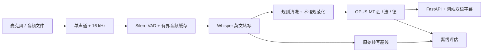

# 英语实时语音翻译

依据项目提案，先在本地建立可运行框架，之后再部署 Hugging Face Spaces。这里的模型搭建指接入和组合预训练模型，第一阶段不从零训练，也不调用 LLM API。

## 整体结构



| 模块 | 当前选择 | 后续扩展 |
| --- | --- | --- |
| ASR | `openai/whisper-base.en` | 对比 `openai/whisper-small.en` |
| VAD | Silero，CPU 执行 | 调整停顿阈值 |
| 翻译 | `Helsinki-NLP/opus-mt-en-es` / `en-fr` / `en-de` | 同一接口下加入 NLLB 对照 |
| 文本处理 | 去口头填充词、有限去重、标点、I 大写、术语别名 | 用消融实验决定规则取舍 |
| 界面 | 本地 HTML/CSS/JS 网站 + FastAPI，保留 Gradio 演示 | 接入已有网站 / HF 部署 |
| 评估 | WER、chrF++、BLEU、得分比、分步时间 | 可选 COMET、人评和直播延迟测量 |

核心代码在 [src/speech_translate](src/speech_translate/)，模型接口在 [models.py](src/speech_translate/models.py)，音频缓存和分段在 [audio.py](src/speech_translate/audio.py)，文本规则在 [text.py](src/speech_translate/text.py)，评估在 [evaluation.py](src/speech_translate/evaluation.py)。

## 安装与运行

建议 Python 3.10–3.12。CPU 可运行，速度需要实测；CUDA 自动选用，Apple MPS 可显式选择。

```bash
python3 -m venv .venv
source .venv/bin/activate
python -m pip install -e '.[dev]'

# 先下载并检查模型；不创建 Space，不上传任何内容。
live-translate preload --languages es fr de

# 启动网站及 API：http://127.0.0.1:8000
live-translate web

# 备选：Gradio 模型演示
live-translate ui

# 指定更大的英文 ASR 模型
live-translate --asr-model openai/whisper-small.en ui

# 缓存齐全以后，HF 模型仅从本地读取
HF_HUB_OFFLINE=1 live-translate --offline ui
```

打开终端输出的本地地址。选择目标语言、分段策略、是否清洗，再开始录音；停止录音会提交剩余片段。更换设置前停止并清空会话。没有检测到人声时不调用 Whisper。

## 接入网站

所有源码都保存在当前本地项目中，不依赖托管网站编辑器。网页文件位于 [web/](src/speech_translate/web/)，后端位于 [server.py](src/speech_translate/server.py)，复用相同的模型与评估代码。前端使用原生 HTML、CSS、JavaScript，无需 Node 构建，也不从 CDN 加载前端依赖。

```bash
live-translate web --port 8000
# 同一局域网访问时显式绑定所有接口；麦克风在非 localhost 上需要 HTTPS。
live-translate web --host 0.0.0.0 --port 8000
```

- `GET /`：网站，包括音频上传、实时录音、双语字幕和文本导出。
- `GET /docs`：可交互 API 文档。
- `GET /api/health`：服务状态和支持的语言；不触发权重加载。
- `POST /api/translate/text`：JSON `{ "text": "Hello.", "language": "es", "clean": true }`。
- `POST /api/translate/audio`：multipart 字段 `audio`、`language`、`strategy`、`clean`；返回双语文本、片段和时间。最大 32 MB、120 秒，支持 WAV/FLAC。
- `WS /api/live`：第一条 JSON 设置 `language`、`sample_rate`、`strategy`、`clean`；收到 `ready` 后发送单声道小端 float32 PCM，每帧最多 2 秒。服务返回 `segment` 和 `ack`；停止时发送 `{ "type": "stop" }`，服务先输出缓存尾段，再返回 `done`。客户端必须等 `ack` 再发下一帧，避免无界排队。

网页用浏览器 AudioWorklet 采集音频，保留最后不足半秒的录音；后端维护独立连接缓存。缓冲积压过多时结束采集并处理已采音频，不静默丢弃。字幕导出为双语 TXT，不包含未经测量的 SRT 时间戳。纯静音会被过滤。

接入已有网站时，可以直接复用 API 和前端调用代码。默认同源服务，不开放跨域；另域部署时再按实际网站域名配置 CORS、身份验证、HTTPS 和资源配额。当前默认绑定 localhost，是本地开发版本。

```bash
live-translate transcribe recording.wav --language es
live-translate --device mps transcribe recording.wav --language fr
live-translate --glossary configs/glossary.example.json ui
python -m pytest -q
```

默认最大音频片段 8 秒，停顿阈值 0.6 秒。`fixed` 按固定时长提交，`pause` 在检测到尾部停顿时提前提交；两者都通过 VAD 过滤纯静音。字幕是片段级更新，不是逐字流式 ASR。模型首次加载会增加等待时间，持续语音最长等到片段上限才提交；不能据此承诺几秒以内的延迟。

## 数据与评估

准备 JSONL，一行一个显式对齐的样本，结构见 [data/example.jsonl](data/example.jsonl)。示例仅展示格式，不附带音频，也不作为评测数据。音频路径相对于清单所在目录。

```json
{"id":"aligned-sentence-id","audio":"audio/001.wav","english":"Hello.","references":{"es":"Hola.","fr":"Bonjour.","de":"Hallo."}}
```

提案使用 FLEURS 英语音频和 FLORES 人工译文。正式评估前需要核实数据版本、划分、句子 ID 和英文文本；不能按两份数据的行号直接拼接。先准备一个人工核对的小样本集，再扩展到固定测试集。框架检查唯一 ID、必需字段、音频存在和非空译文，但不能代替语义对齐审核。

```bash
live-translate evaluate data/test.jsonl --languages es fr de --output outputs/evaluation.json
live-translate evaluate data/test.jsonl --languages es --strategy fixed --output outputs/fixed.json

# 可选，安装后会另行下载较大的 COMET 模型
python -m pip install -e '.[comet]'
live-translate evaluate data/test.jsonl --languages es --comet
```

每种语言分别比较：

1. **gold_text**：人工英文转写 → 同一个翻译模型 → 人工目标译文评分。
2. **raw_asr**：原始 ASR → 同一个翻译模型 → 同一人工译文评分。
3. **processed**：相同 ASR 片段 → 文本处理 → 同一个翻译模型 → 同一人工译文评分。

主要目标为 `processed chrF++ / gold_text chrF++ >= 0.80`，不是 BLEU 达到 80。分母为零时比值不可定义；比值不强制截断到 1。负的清洗增益也如实输出。WER 使用明确的大小写/标点归一化。冷启动加载排除在离线 RTF 外；音频归一化、VAD、ASR、清洗、翻译都计入语音管线总时间，另外两组基线翻译与指标计算不计入。

提案还要求 COMET ≥ 0.80、人评平均 ≥ 4/5 和直播延迟。可选 COMET 输出固定 checkpoint 的原始分值，阈值解释需要结合该模型；人评与完整录音到字幕延迟尚需专项实验。离线 RTF 不能替代直播延迟。

## 当前边界与下一步

- 已实现模型适配、两种音频分段、文本清洗、术语别名、网站及 API、Gradio 演示和离线评估。
- [SentenceBuffer](src/speech_translate/text.py) 提供标点缓存原语，尚未接入界面和评估；标点分段对比仍是后续任务。
- 当前不做激进缩写展开、英文数字词转数字或自动人名恢复；缺少依据时这些规则会改变意思。规则需要通过真实测试集再增加。
- 未进行微调，也未默认接入 NLLB。若基线错误分析支持微调，再准备训练/验证/测试划分和训练脚本。
- Gradio 已提供浏览器麦克风输入，当前无需 `sounddevice`；需要独立桌面录音程序时再加入。
- 不声称已达到准确率或速度目标；没有正式对齐测试集时，只能验证工程链路。
- 本机已验证 Whisper、Silero 和三种 OPUS-MT 权重加载。公开 10.435 秒音频已产生英文转写及西/法/德输出；CPU 上西语两个片段的计算 RTF 约为 2.21 和 2.68，尚未达到实时目标。这是单样本冒烟验证，不是准确率评估。分段截断导致的词句错误也需要后续优化。
- 建议顺序：小样本端到端验证 → 对齐数据 → 各语言基线 → 文本/分段消融 → 速度调优 → HF Spaces。

参考：[Whisper 模型卡](https://huggingface.co/openai/whisper-base.en)、[OPUS-MT 模型卡](https://huggingface.co/Helsinki-NLP/opus-mt-en-es)、[Silero VAD](https://github.com/snakers4/silero-vad)。翻译直接使用模型和 tokenizer，不依赖 Transformers 的 translation pipeline。
# Translation-
